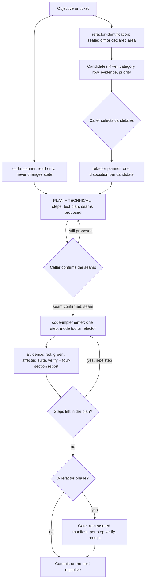

# Agents

An agent is a directory with an `AGENT.md`: a prompt a harness runs as its own
worker, with tools, turn limits and a model. The category groups agents by
domain and never changes what one can do. The name in the frontmatter is what a
harness matches.

Each agent here states its contract: what it returns, what it must not touch,
where its evidence comes from. The planner stops at a plan, the implementer at
one step, the scout at findings. A reader can tell from the file what a run
will produce, before running it.

## How a plan reaches an implementer

Two lanes feed the same plan: a change to code goes straight to the planner,
while a refactor passes through detection first, and only the candidates the
caller selects reach the refactor planner. A refactor phase adds a gate before
the commit, documented in [`../docs/refactor-phase.md`](../docs/refactor-phase.md).

The planner never confirms its own seams and the implementer never reopens the
plan, so the caller makes the only decisions in the loop: which candidates to
plan and which seams to confirm.

To install an agent into a harness, see [`../docs/installation.md`](../docs/installation.md).
The list below is generated from each `AGENT.md`; rules for adding one are in
[`../AGENTS.md`](../AGENTS.md).

<!-- GENERATED:BEGIN -->
| Agent | Category | What it does |
|---|---|---|
| [`code-implementer`](./coding/code-implementer/AGENT.md) | `coding` | Implements one planned step in a declared mode, with persisted evidence. |
| [`code-planner`](./coding/code-planner/AGENT.md) | `coding` | Plans a change to code: decisions, contracts, test seams, ordered steps. |
| [`refactor-planner`](./coding/refactor-planner/AGENT.md) | `coding` | Plans a refactor from frozen candidates: dispositions, steps, evidence. |
| [`analyst`](./general/analyst/AGENT.md) | `general` | Reviews an artifact against explicit criteria and labels every claim. |
| [`planner`](./general/planner/AGENT.md) | `general` | Plans non-code work: tasks, projects, research, documents, writing. |
| [`scout`](./research/scout/AGENT.md) | `research` | Finds files, symbols and references in a codebase, without analyzing them. |
| [`web-scout`](./research/web-scout/AGENT.md) | `research` | Searches the web and returns a URL and a quote for each claim. |
<!-- GENERATED:END -->
