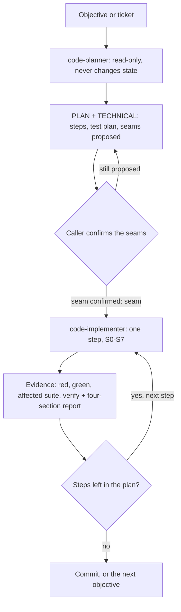

# Agents

Each agent is a directory with an `AGENT.md`: a subagent a harness runs with its own prompt, tools and turn limits. Categories group agents by domain; the category is navigation, the name is identity.

Because harnesses read agents one directory level deep, a category layout needs one flattening step. `scripts/link_agents.sh` links every agent into the harness directory and never deletes anything:

```sh
scripts/link_agents.sh --dry-run
scripts/link_agents.sh
```

Rules for adding one are in `AGENTS.md`.

## How a plan reaches an implementer



The planner never confirms its own seams and the implementer never reopens the plan, so the confirmation is the only decision the caller makes.

<!-- GENERATED:BEGIN -->
| Agent | Category | What it does |
|---|---|---|
| [`code-implementer`](./coding/code-implementer/AGENT.md) | `coding` | Implements one step of a code-planner plan, or one caller-named seam, through a fixed S0-S7 TDD state machine: one test at a time, red then green, the affect... |
| [`code-planner`](./coding/code-planner/AGENT.md) | `coding` | Read-only planner for objectives whose deliverable is a change to files in a code repository. Produces a complete PLAN / TECHNICAL implementation plan with r... |
| [`analyst`](./general/analyst/AGENT.md) | `general` | General-purpose analyst for code reviews, document audits, research and any investigation. Measures artifacts against explicit criteria with labeled evidence... |
| [`planner`](./general/planner/AGENT.md) | `general` | Read-only planner for non-code deliverables: tasks, projects, research, documents and general work. Returns a complete PLAN / TECHNICAL plan, or BLOCKED when... |
| [`scout`](./research/scout/AGENT.md) | `research` | Fast codebase recon: finds files, symbols, patterns, and references. No analysis, no evaluation, no implementation. Returns compressed findings (file paths,... |
| [`web-scout`](./research/web-scout/AGENT.md) | `research` | Fast web searcher: one batched search, up to two fetched sources, URL and verbatim quote per claim; accepts an optional lens file for structured multi-source... |
<!-- GENERATED:END -->
